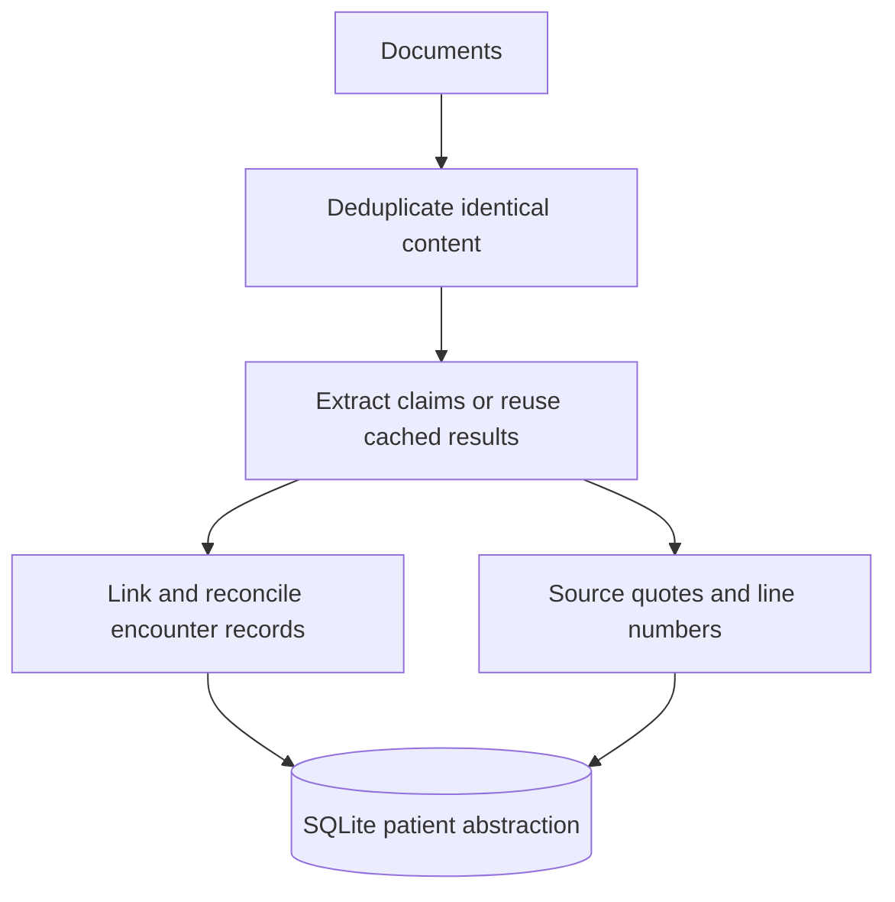
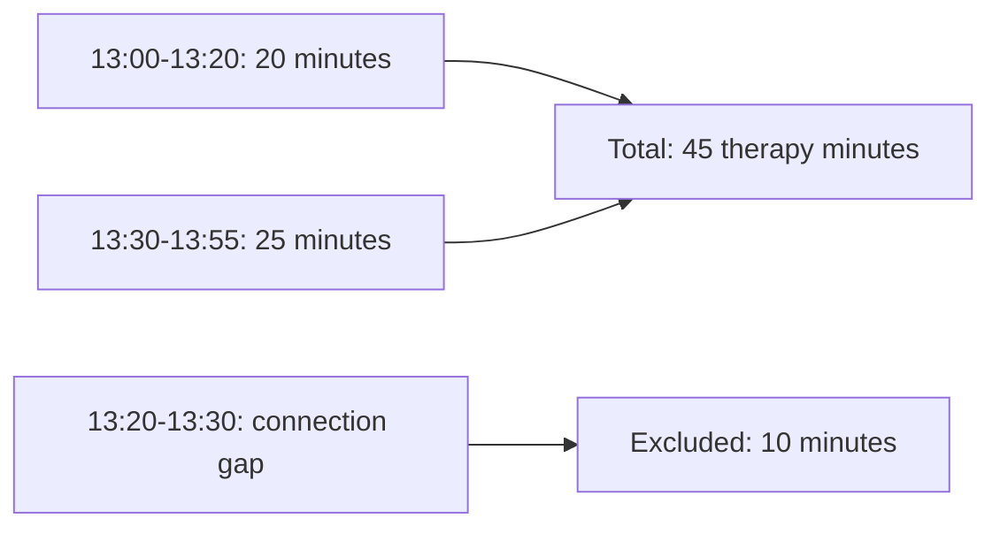

# Backbone Clinical Review

A Python CLI that extracts source-linked claims, reconciles encounters, and
calculates therapy counts, minutes, weekly goals, cohorts, plan comparisons, and
symptom timelines. SQLite retains immutable sources, extraction caches, and
published patient revisions. One structured LLM call plans each new question;
code calculates answers from saved evidence. Saved plans execute without model calls.

- `process` saves source documents, extracted evidence, and the patient abstraction in SQLite.
- `ask` and `answer-file` read the saved abstraction from SQLite.
- `answer-file` and `export` also write JSON copies of the abstraction and plans for review.
- `replay` reads those exported JSON files without accessing SQLite or calling a model.

## Run

Requires Python 3.12+ and [uv](https://docs.astral.sh/uv/).

```sh
uv sync --frozen
cp .env.example .env
```

Set `OPENAI_API_KEY` in `.env`, then:

```sh
# Build and save the abstraction in SQLite using gpt-4.1 and four workers.
uv run backbone process documents --model gpt-4.1 --workers 4

# Answer every question in ./questions.json and save the results in ./artifacts.
uv run backbone answer-file questions.json --output artifacts

# Display one answer in the terminal and save its plan for offline replay.
uv run backbone ask "How many therapy minutes did Rowan receive on January 21, 2026?" \
  --save-plan .backbone/query-plan.json

# Identify patients with two consecutive weeks below their treatment requirements.
uv run backbone ask "Which patients had two consecutive weeks below their treatment requirements?"

# Export answers, abstraction, plans, extractions, and logs for review.
uv run backbone export questions.json --output artifacts

# Repeat each saved plan ten times to measure calculation and rendering latency.
uv run backbone benchmark artifacts/benchmark_questions.json \
  --plans artifacts/benchmark_plans.json --repeats 10

# Measure end-to-end queries, zero-model replay, token usage, and estimated cost.
uv run backbone benchmark-live artifacts/benchmark_questions.json \
  --model gpt-4.1-mini --repeats 3 \
  --input-rate-per-million 0.4 --output-rate-per-million 1.6

# Use a new database to measure initial processing time, token usage, and estimated cost.
uv run backbone --db .backbone/initial-measurement.sqlite3 benchmark-process documents \
  --model gpt-4.1 --workers 4 --input-rate-per-million 2 --output-rate-per-million 8
```

Process a new file or directory with the same `process` command. Unchanged files
reuse the extraction cache; updates rebuild affected patients. An extraction
failure preserves the published revision and reports incomplete source coverage.
Retry the same input to reuse successful extractions.

Use `ask --snapshot N` to select a published version. `rebuild` recomputes the
abstraction from saved claims without API calls. `--db PATH` precedes the
subcommand and selects a separate database.

Browse updates for a stored patient ID, then select a revision or publication time:

```sh
uv run backbone history "harbor grove behavioral health::HG-M042"
uv run backbone patient "harbor grove behavioral health::HG-M042" --snapshot 2
uv run backbone patient "harbor grove behavioral health::HG-M042" \
  --as-of "2026-10-13T17:26:00-04:00"
uv run backbone ask "How many therapy sessions did Rowan attend?" \
  --as-of "2026-10-13T17:26:00-04:00"
```

- `history`: List the patient's saved versions and when each was published.
- `patient --snapshot 2`: Show the patient's record in system version 2.
- `patient --as-of "TIMESTAMP"`: Show the patient's record saved by that time.

The repository includes processed data and plans for the five submitted questions.
Use `replay` to recalculate those answers without an API key or SQLite database:

```sh
uv run backbone replay artifacts/abstraction.json questions.json \
  --plans artifacts/plans.json --output .backbone/replay
```

For your own documents and new questions, use `process` and `ask` with an API key.

- `OPENAI_MODEL`: Model used to extract evidence from documents.
- `OPENAI_QUERY_MODEL`: Model used to understand new questions; defaults to `OPENAI_MODEL`.
- The query model receives patient names, IDs, organizations, and available dates.
  Code checks its plan and calculates answers from the saved abstraction.
- Questions can cover multiple patients and tasks. Ambiguous requests need clarification;
  unsupported requests return an error.

Saved plan options:

- `ask --plan PATH`: Reuse one saved plan without another planning call.
- `ask --context PATH`: Give the model a previous plan to interpret a follow-up question.
- `--plans PATH`: Reuse saved plans for batch questions.
- `answer-file` and `export` save generated plans in `plans.json`.

Saved plans must match the exact question and snapshot. The submitted plans came
from live model calls; [validation](artifacts/planner_validation.json) checks the
patient, dates, task, results, and source locations.

Answers use saved patient data and source references. Vector search is not implemented.
A valid plan can still misinterpret a question; correct JSON alone does not prove correct intent.

## Evidence and uncertainty

### How are documents deduplicated, linked, and traced to their sources?

- Identical file contents are stored once. Extraction results are reused when
  the content and extraction settings match; earlier caches remain readable.
- Records describing the same encounter are linked using encounter or appointment
  IDs. Ambiguous matches remain unresolved.
- Each claim retains its document ID, filename, line range, and exact source quote.
  New extractions require separate quotes for plan goals, effective dates, and stated minutes.
- An explicit correction changes only the fields it names. Later copies of an
  earlier record do not undo that correction.



### How are therapy minutes calculated when records disagree?

Include contacts that qualify under the effective treatment plan. Calculate the
overlap between patient attendance and therapy activity, excluding documented
nontherapeutic breaks and connection gaps.

For example, the [January 21 telehealth record](documents/BH-D106_telehealth_2026-01-21.txt)
supports 45 therapy minutes:



Conflicting final records retain all supported alternatives. Each calculation
scenario uses consistent choices across events and weeks. Exceeding the scenario
budget reports incomplete analysis. Partial-week coverage and unclear plan
transitions retain qualified goal decisions.

### What do the supplied records establish?

| Finding | Result |
| --- | --- |
| Eligible therapy sessions | 12 |
| Distinct therapy days | 11 |
| Total therapy minutes | 585 or 595 |
| Final week's therapy minutes | 145 or 155 |
| Final week's plan compliance | Indeterminate |

Two final records report [40 minutes](documents/BH-D111_individual_second_record_2026-01-26.txt)
and [50 minutes](documents/BH-D110_individual_primary_record_2026-01-26.txt) for the
same January 26 encounter. The alternatives put the final week below or above its
150-minute goal. Both interpretations meet the three-day goal, so duration prevents
a definitive compliance answer. These results are calculated from evidence;
production code contains no patient-specific facts or answers.

### What is needed to resolve an uncertain answer?

Clinical documentation requests identify the patient, dates, and disputed or
missing field, with event or assessment IDs where available.
January 26 needs an explicit duration correction identifying the assertion it
replaces, or actual patient-contact start/end times and a break record.

| Limitation | Next step |
| --- | --- |
| Conflicting or missing clinical evidence | Obtain documentation for the identified event and field. |
| Failed or pending source processing | Complete processing of the existing documents, then rerun the question. |
| Scenario budget exceeded | Increase the analysis budget and rerun the calculation. |
| Query covers only part of a week | Expand the query range before judging the whole week's goal. |

Symptom answers separate distinct assessments, numerical score changes, attributed
observations, and reasons for additional contacts. A lower score alone does not
establish recovery.

### How are multi-patient queries and plan changes demonstrated?

The separate [synthetic demo](demo/README.md) contains three patients:

| Patient | Demonstration |
| --- | --- |
| Casey Demo | Confirmed member of the consecutive two-week shortfall cohort. |
| Morgan Demo | Possible member because conflicting durations change goal decisions. |
| Alex Demo | Excluded from that cohort; has a documented treatment-plan change. |

`backbone demo` uses authored extraction fixtures and saved plans to exercise
processing, reconciliation, and calculation without API calls. A separate
[live benchmark](demo/artifacts/full-query-benchmark.json) checks model planning.
Synthetic records and outputs stay separate from the original five answers.

## Submission

| File | Contents |
| --- | --- |
| [answers.md](artifacts/answers.md) / [answers.json](artifacts/answers.json) | Five development answers, calculations, exclusions, uncertainty, and source passages. |
| [plans.json](artifacts/plans.json) / [benchmark_plans.json](artifacts/benchmark_plans.json) | Saved query tasks for offline execution. |
| [abstraction.json](artifacts/abstraction.json) | Published patient records and source coverage. |
| [extractions.jsonl](artifacts/extractions.jsonl) | Validated model claims before reconciliation. |
| [execution.jsonl](artifacts/execution.jsonl) | Processing and query execution logs. |
| [query_planning_checks.json](artifacts/query_planning_checks.json) | Synthetic live-API intent and field-grounding checks, including the observed failure and retry. |
| [full-query-benchmark.json](artifacts/full-query-benchmark.json) / [planner_validation.json](artifacts/planner_validation.json) | Fresh planning, stage timings, tokens/cost, saved-plan replay, and reference checks. |
| [initial-processing.json](artifacts/initial-processing.json) / [clean_environment.json](artifacts/clean_environment.json) | Complete new-database measurement and isolated-wheel verification. |
| [benchmark.json](artifacts/benchmark.json) / [performance.json](artifacts/performance.json) | Saved-plan calculation timings and earlier separate-stage processing measurements. |
| [demo/artifacts](demo/artifacts) | Separate synthetic abstractions, source-linked answers, fixtures, and live planning measurements. |

## Measurements and model

The isolated wheel run at `396ed6b` processed 31 new records in **36.043 seconds**,
including database initialization, ingestion, extraction, reconciliation, and
publication. It used `gpt-4.1-2025-04-14`, 134,470 input / 25,265 output tokens,
and an estimated **$0.47106**. A preceding 40.096-second attempt rejected one
non-verbatim quotation and published no snapshot; its report is retained in
[initial-processing-failed.json](artifacts/initial-processing-failed.json).
The successful measurement uses another empty database, without extraction caches.

Extraction uses Responses structured outputs, temperature 0, 12,000 maximum
output tokens, and four workers. A failed local evidence check gets one retry.
Code attaches exact quotation locations. Planning uses structured outputs,
5,000 maximum output tokens, and provider-default sampling.
See [OpenAI Structured Outputs](https://developers.openai.com/api/docs/guides/structured-outputs).

Fresh query measurements use `gpt-4.1-mini-2025-04-14` and three repeats per
question. Every repeat calls the planner and reloads the SQLite snapshot.
Each table cell is its stage median; separate medians need not sum.

| Query | Database (ms) | Planning (s) | Calculation/render (ms) | End to end (s) | Saved-plan replay (ms) |
| --- | --- | --- | --- | --- | --- |
| DEV-01: counts | 3.408 | 1.453 | 3.177 | 1.460 | 7.268 |
| DEV-02: minutes | 3.150 | 2.095 | 6.529 | 2.104 | 10.330 |
| DEV-03: weekly goals | 3.397 | 1.470 | 5.106 | 1.479 | 9.530 |
| DEV-04: selected dates | 3.770 | 1.451 | 2.594 | 1.457 | 9.613 |
| DEV-05: symptoms | 3.986 | 1.495 | 4.175 | 1.503 | 9.691 |
| COHORT-01: supplied collection, one patient | 3.343 | 1.208 | 4.319 | 1.215 | 8.915 |
| SYN-01: individual | 1.496 | 1.444 | 0.651 | 1.447 | 3.157 |
| SYN-02: three-patient cohort | 1.708 | 1.394 | 3.572 | 1.398 | 5.906 |
| SYN-03: plan comparison | 1.515 | 1.339 | 1.538 | 1.342 | 5.517 |

The original workload used 18 calls, 30,147 input / 2,667 output tokens, estimated
$0.016326. The synthetic workload used nine calls, 16,440 input / 1,105 output
tokens, estimated $0.008344. All 27 saved-plan replays match their corresponding
fresh answers without model calls. Independent gold checks pass all 15 original
five-question runs and all nine synthetic runs. One weekly answer varies whether
it also displays the session count; its totals and goal decisions agree.

Prices are standard uncached estimates at [$2/$8 per million input/output tokens
for gpt-4.1](https://developers.openai.com/api/docs/models/gpt-4.1) and
[$0.40/$1.60 for gpt-4.1-mini](https://developers.openai.com/api/docs/models/gpt-4.1-mini).
Actual billing, cache discounts, the failed attempt, and other development probes
are excluded from each successful workload estimate. Unconfigured prices yield
null costs. Reports retain stage samples, model names, tokens, rates, and scope.
Query timing excludes CLI startup, report serialization, and output writes;
replay includes database loading but excludes reading the saved-plan file.
These small samples do not establish tail latency or large-collection capacity.

[Clean-environment verification](artifacts/clean_environment.json) records the
wheel hash, source commit, locked dependencies, source hashes, and identical
exports/replays with an empty API key and a nonexistent database path.
[performance.json](artifacts/performance.json) retains the earlier separate-stage
processing measurement. Earlier synthetic planning/grounding probes are in
[query_planning_checks.json](artifacts/query_planning_checks.json).

Exact quotations do not establish semantic correctness. Verification covers
these supplied and synthetic questions; it is not a broader accuracy estimate.
Next, test unseen records against labeled contact times and record statuses, and
test question paraphrases against expected patient, date, and task selections.
Earlier miniature-model extraction trials misclassified timing and altered
quotations, so extraction and planning use different models here.
OpenAI Codex and collaborating coding agents assisted implementation and review.
No coding-assistant sampling settings were configured in the repository.

## Scale

The first expected cold-processing bottleneck at one million documents is model
token volume and rate limits in `workflow.extract_documents`. Use bounded queue
workers, persistent jobs, batch requests, and incremental source discovery.
Current ingestion and futures are held in memory; they need streaming batches.

Query planning currently sends the patient catalog to the model; at larger
patient counts, retrieve entity candidates and resolve cohort scopes in the
database before planning. Queries currently load patient JSON and cached source contexts through
`Store.snapshot`; collection-wide queries run scenarios for every selected
patient in memory. Normalize events and
patient-week aggregates, index date/patient filters, and invalidate affected
weeks on publication. SQLite has one writer; move revision publication to a
transactional shared store when concurrent writers are needed. The 31-document,
one-patient measurement and the three-patient synthetic measurement do not establish
500K-document or million-document capacity.
See [architecture](docs/SYSTEM_ARCHITECTURE.md) for the expansion path.

## Verify

```sh
uv run pytest
uv run mypy src tests
uv run ruff check src tests
uv run python -m scripts.validate_submission artifacts/full-query-benchmark.json
uv run python -m scripts.validate_demo demo/artifacts/full-query-benchmark.json
```

Tests include exact source grounding, the five reference answers, scoped
corrections, duplicates, conflicting times/dates, unknown attendance, coupled
scenarios, cohort membership, plan changes, retries, revisions, and CLI restart
and replay behavior. Planner tests cover compound tasks, relative dates, missing
context, disputed anchors, unsupported requests, SDK failures, and saved-plan
validation. All authored project content is English.
