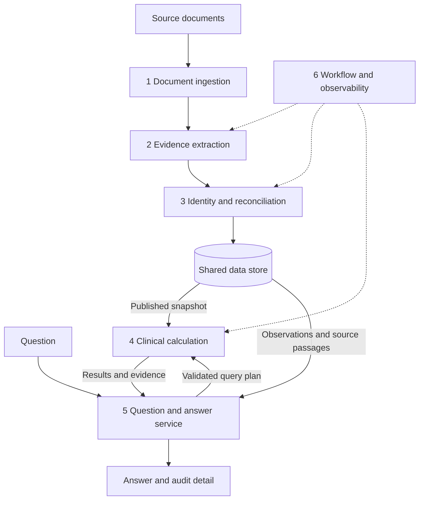

# Clinical Review System Architecture

The proposed system has six logical modules and one shared persistence layer.
Document processing builds a reusable clinical abstraction; questions execute
against a published version of that abstraction. Evidence extraction,
reconciliation, and calculation have separate responsibilities so that model
output does not silently become a clinical total.

The prototype can run in one Python process with SQLite and local source files.
The module interfaces should remain stable when extraction moves to workers,
source files move to object storage, or the relational database changes. This
design follows the behaviors in [DESIGN_REQUIREMENTS.md](DESIGN_REQUIREMENTS.md);
the technology choices below are proposals rather than submission requirements.

## Module responsibilities and interfaces

| Module | Input | Output | Responsibility |
| --- | --- | --- | --- |
| 1 Document ingestion | Source bytes and file metadata | DocumentRecord | Register immutable sources, preserve source identity and text locations, detect exact duplicate inputs, and schedule extraction when needed. |
| 2 Evidence extraction | DocumentRecord and extraction configuration | ClaimBatch | Extract source-backed assertions about identity, encounters, attendance, contact intervals, plans, assessments, and document relationships. Validate structure and passage references. |
| 3 Identity and reconciliation | ClaimBatch and relevant existing evidence | PatientChangeSet | Link assertions to patients and clinical events; resolve fields when justified; retain unresolved alternatives, source relationships, and decision reasons. |
| 4 Clinical calculation | Published or staged patient view, calculation rules, and QueryPlan | MetricResult | Calculate eligible sessions, days, minutes, weekly goals, plan comparisons, and cohort conditions, including evidence contributions and uncertainty dependencies. |
| 5 Question and answer service | Question and published snapshot | QueryPlan and AnswerBundle | Interpret query scope, validate supported operations, invoke calculation, retrieve relevant observations and passages, and render a grounded answer. |
| 6 Workflow and observability | Processing jobs, configuration, and module events | Job records, published revisions, and performance reports | Coordinate dependencies, retries, revision publication, cache validity, and measurement. Maintain the same behavior in synchronous and worker-based execution. |

These are module boundaries, not six independently deployed services. Storage
adapters are shared infrastructure. The question service includes query planning
and answer rendering; those can be separate classes without another deployment.

## Main data flows

The arrows show logical data flow. Ingestion and extraction also persist source
records and claims. Workflow coordinates the short transaction that publishes
reconciled data and any required summaries; reconciliation does not independently
overwrite the shared state.

### Processing a document

Ingestion stores the source and stable text locations. Extraction emits claims,
each linked to a passage. Reconciliation gathers the relevant existing claims
and produces a proposed change to the affected patient's view. Workflow runs
needed calculations and publishes a new revision once the change is coherent.

Claims can describe more than one patient or event. Routing follows the linked
entities rather than assuming that each file corresponds to one patient or
session. Ambiguous identities remain explicit and do not silently become new
patients or forced matches.

### Answering a question

The question service resolves patient or collection scope, date range, metrics,
and comparison windows into a validated query plan. It fixes a published snapshot
before calculation. The calculation module returns results with contributions,
exclusions, applicable rules, and unresolved dependencies. The answer service
uses that result and relevant observations to produce English output with sources.

A new question makes one planning call and reuses saved claims and reconciled data.
Saved query plans reproduce execution without model calls. Planning metadata and
execution latency are measured separately. Targeted passage checks
or narrowly scoped enrichment can address information absent from the current
abstraction without rebuilding the collection.

## Document ingestion

Keep original source bytes immutable. A content hash can identify exact copies,
while received filenames and external document IDs remain metadata. An external
document ID alone is not a sufficient content version: a changed file may retain
that ID.

Store parsed text with its parser version and stable line or character locators.
Claims reference the text version actually used for extraction. A parser change
must not leave old offsets pointing into different text.

Exact duplicate input should reuse existing processing and leave clinical results
unchanged. Distinct files that describe the same event are handled by
reconciliation rather than file hashing.

## Evidence extraction

The extraction contract contains assertions, not final patient summaries. Useful
fields include the subject identity, external event IDs, asserted field and value,
service or observation time, document status, source passage, and any explicit
correction or copied-record relationship.

Use deterministic parsing for well-defined identifiers and tables where it is
reliable. Model extraction can interpret narrative content and plan language.
Validate the structured output and verify that referenced passages exist in the
retained source. A valid passage reference is necessary but does not by itself
prove that the assertion correctly interprets the passage.

The extraction cache key includes source content, text/parser version, extraction
schema and prompt version, model configuration, and relevant settings. A model
call completing twice must not insert duplicate assertions. Failed extraction
must remain visible as a coverage limitation rather than looking like a document
with no relevant care.

Retain extraction runs as versioned interpretations of the same source. Each
published revision selects the active claim set for a document. A newer extraction
run can replace the active interpretation while retaining the old run for audit;
the two runs must not be treated as independent clinical sources whose differences
create artificial corroboration, duplicate care, or a clinical conflict.

## Identity and reconciliation

Match explicit patient, encounter, appointment, and assessment identifiers first,
with identifiers scoped to their issuing organization when needed. For records
without usable identifiers, build candidate matches from available identity,
date, service, and episode information. Preserve the basis for a match or the
remaining ambiguity.

Reconciliation operates on the relevant patient and candidate events, not the
entire document collection. Sources can contribute complementary fields: an
attendance record may establish patient presence while a clinical note supplies
therapeutic activity intervals and breaks.

Store reconciliation decisions separately from their source claims. A decision
names its target field, supporting and conflicting evidence, resolution reason,
and rule version. An explicit departure-time correction affects that field;
a later retransmission of the original record does not revoke the correction.
Two final records claiming different full durations remain disputed unless
additional evidence resolves the conflict.

Avoid embedding the whole patient chart in every reconciliation prompt. Apply
explicit relationships and deterministic rules first. Where interpretation
requires a model, provide a small evidence bundle relevant to the disputed event
or field. The model proposes a scoped, evidence-backed decision, which must pass
the applicable resolution rules or validation before adoption. Model confidence,
preference, or apparent plausibility cannot break an otherwise unresolved conflict
between final records. Retain the proposal and accepted decision for review.

## Clinical calculation and uncertainty

Calculation receives a consistent patient view and applicable plan definitions.
It counts clinical encounters rather than documents, distinguishes encounter
count from distinct service days, and calculates delivered contact intervals in
code. Group attendance is intersected with therapeutic activity; telehealth
reconnections remain segments of one encounter when supported by the evidence.

A MetricResult includes the value or supported alternatives, contributing
encounters, excluded records and reasons, formulas, rule version, snapshot
reference, and relevant source claims. Plan evaluation uses effective periods
and explicit definitions. Missing midweek transition or partial-week policy is
reported rather than silently invented.

Uncertainty belongs to the affected field or identity. An encounter can be
established while its duration remains disputed. Unknown duration is not zero,
and missing documentation does not prove nonattendance.

Evaluate goals over consistent interpretations of the record. A goal is met if
all supported interpretations meet it, not met if all fail it, and indeterminate
when decisions differ or evidence is insufficient. An exact duration can remain
unresolved while the goal decision is established.

For collection questions, preserve correlations across weeks. The condition
"has N consecutive weeks below requirements" must be evaluated within each
consistent interpretation. Established membership means every interpretation
contains some consecutive failing window; the window need not be identical across
all interpretations. Independent weekly labels can lose that information.

Analyze uncertainty in connected dependency groups and use sound bounds when
they prove the outcome. Avoid enumerating unrelated alternatives together. If
analysis cannot settle a result within the available budget, retain the
unresolved condition and explain the limitation rather than selecting a value.

Represent analysis completion and proof status separately from evidential
ambiguity. For example, an indeterminate result can have reason
`analysis_budget_exceeded`, `conflicting_evidence`, `missing_evidence`, or
`missing_policy`. Report possible cohort membership only when a feasible
supporting interpretation has actually been established. Incomplete analysis
alone does not prove that membership is possible or impossible.

## Question and answer service

A query plan represents the operation, patient or cohort scope, date bounds,
grouping, service filters, applicable plan rules, and comparison windows. The
prototype needs a small set of composable operations for counts, durations, plan
evaluation, timelines, symptom observations, and cohort conditions.

Natural-language interpretation uses one structured model call. `planning.py`
resolves typed patient/time intents into a multi-task `QueryPlan`; code validates
patient IDs, date bounds, documented anchors, and supported operations. A saved
plan pins the question and snapshot and runs without another model call. Execution invokes known calculation operations; generated language
does not perform the arithmetic or determine which evidence wins.

For symptom questions, retrieve distinct assessments and attributed observations
in event-time order. Copies of a questionnaire are additional provenance rather
than additional measurements. Render numerical and clinical findings alongside
what remains unresolved; avoid unsupported causal or recovery conclusions.

An AnswerBundle retains the validated query plan, structured results, source
references, assumptions, uncertainty, and snapshot reference. Narrative rendering
must preserve the calculator's values and decisions. Required numerical and
status fields can be rendered directly from structured results, with any model
summary checked against those results.

## Persistence and revision consistency

Separate four kinds of stored information:

| Stored information | Purpose |
| --- | --- |
| Immutable sources and passages | Recover exactly what each document said and what was extracted. |
| Extracted claims | Reuse document understanding without losing conflicting evidence. |
| Reconciled patient revisions | Publish inspectable encounters, plans, assessments, and field decisions. |
| Derived results and run records | Reuse calculations, audit answers, and measure execution. |

Perform model calls and expensive calculations outside long database write
transactions. Build a staged change from a known patient revision, then use a
short transaction to check that the base revision is still current and publish
the change. If another update intervened, reuse extracted claims and reconcile
again against the new base.

An identity move, patient merge, or correction affecting multiple patients must
publish one logical change set atomically across every affected patient. Check
all base revisions before commit and retry the related change set if any changed.
A stable collection snapshot cannot compensate for a transfer published in two
steps that temporarily loses or duplicates an encounter.

A published patient revision must include coherent encounters, plans, and
assessment decisions. Materialized summaries must either match that revision or
be explicitly unavailable; an old summary cannot be presented as current. The
prototype can compute affected summaries before publication. Larger deployments
can compute them asynchronously, with on-demand calculation or an explicit
pending status until matching results are ready.

Pin each answer to a published snapshot and matching calculation-rule version.
Collection queries need a consistent snapshot of published patient revisions.
Patient history joins `patient_versions` to publication timestamps in `revisions`.
History includes removals and records only that patient's versions. A timestamp
lookup selects the latest published revision at or before an aware UTC instant;
the patient lookup then carries forward its latest version in that snapshot.
Publication time and clinical event time are distinct. The publication-time
index supports the global cutoff; the patient/revision primary key supports
patient history and state lookup. These APIs do not invoke query planning.

Fetch the necessary evidence and results before narrative rendering rather than
holding a database read transaction open throughout a model call. Retained
revision references allow audit and reproduction after subsequent updates.

## Incremental updates

Route a new document through the same ingestion and extraction interfaces.
Reconcile only the affected entities, with their relevant existing evidence.
Invalidate results using dependencies on encounters, plans, assessments, and
patient revisions.

Use service dates and plan effective periods to locate affected time windows.
A correction received today can change a historical week. A plan correction can
affect several weeks and before-and-after comparisons. If patient identity is
changed, both the previous and new patient views may need rebuilding.

For the prototype, recomputing the affected patient's saved abstraction and
metrics from cached claims is a reasonable simplification. This still avoids
re-extracting unchanged documents. Finer event- and week-level dependency tracking
can follow when measurements justify it. Consecutive-week results must account
for neighboring weeks and any uncertainty dependency extending beyond them.

Calculation cache keys include query parameters, patient revisions or collection
snapshot, and calculation-rule version. Extraction and calculation caches serve
different purposes and should not share a single validity flag.

## Scaling the same design

| Area | Prototype | Expansion when needed |
| --- | --- | --- |
| Execution | One process and synchronous module calls | Durable jobs and bounded extraction workers; reconcile and publish independent patients in parallel. |
| Source storage | Immutable local files | Object storage with stable content and passage references; keep large source text out of aggregate query paths. |
| Structured state | SQLite with short writes | PostgreSQL when distributed access or measured write contention requires it; retain the same domain contracts. |
| Reconciliation | Explicit IDs and patient-scoped evidence | Indexed candidate matching and targeted evidence bundles; control hot patients without serializing the entire collection. |
| Patient queries | Query saved encounters and observations | Index patient, service date, event identity, and revision; fetch passages only for returned findings. |
| Collection queries | Calculate from saved patient data | Maintain revision-aware patient-week summaries; filter candidates first and expand disputed cases as needed. |
| Uncertainty | Explicit small alternative groups | Analyze connected dependencies, use provable bounds, and cap unresolved analysis without manufacturing certainty. |

Document extraction can run independently for different sources. Patient updates
require ordering or revision conflict checks. A queue can deliver the same job
more than once; unique processing keys and transactional publication must keep
state updates idempotent. This does not guarantee that a repeated model request
will incur no cost, so in-flight job tracking and cached completed results matter.

SQLite WAL permits concurrent readers and a writer, but only one writer at a
time. That limitation motivates moving beyond a local writer as ingestion
concurrency grows; document count alone is not the migration threshold.
[SQLite WAL documentation](https://www.sqlite.org/wal.html)

PostgreSQL Repeatable Read provides a stable view across successive reads in a
transaction. It is one option for assembling a collection snapshot, alongside
application revision controls. Snapshot isolation alone does not replace atomic
publication or protect every cross-row business invariant.
[PostgreSQL transaction isolation documentation](https://www.postgresql.org/docs/current/transaction-iso.html)

## Expected bottlenecks and measurements

The first expected cold-processing bottleneck is extraction token volume, model
latency, or provider throughput limits. This is a hypothesis to test, not a
measurement. Re-extracting the corpus for each question would repeat that cost;
persistent claims and separate query execution avoid that design dependency.

The next risks depend on the workload: global pairwise event matching, oversized
patient evidence bundles, write contention, unindexed collection scans, or an
explosion of correlated alternatives. Candidate indexing, patient-scoped updates,
short transactions, revision-aware summaries, and bounded dependency analysis
target these risks separately.

Measure initial ingestion and abstraction construction, warm patient questions,
collection questions, duplicate imports, and ingestion of a new correction.
Record per-stage time, model calls and tokens, available cost, cache hits,
processing failures, storage size, and query latency. Attribute projected
bottlenecks to concrete functions when code exists. Report estimates separately
from observed values; no million-document performance claim follows from the
small development dataset alone.

## Checks that exercise module interactions

- Reimport an exact document: reuse extraction and preserve clinical results.
- Add a second description of an encounter: attach evidence without adding a session.
- Add an explicit departure correction, then an old roster copy: preserve the
  scoped correction and recalculate affected historical results.
- Add a conflicting final duration: retain one encounter and propagate duration
  alternatives without changing unrelated facts.
- Reconnect a telehealth appointment: combine contact segments without counting
  the gap or creating another encounter.
- Import a copied questionnaire: add provenance without a new assessment date.
- Restart and ask a new date range: reuse saved abstraction and calculate dynamically.
- Ask during an update: return one published snapshot with no mixed-revision totals.
- Evaluate a cohort with correlated weekly alternatives: preserve consistent
  interpretations across the entire cohort condition.

## Implementation sequence for the prototype

Start with source registration and persistent claims. Add encounter and assessment
linking, explicit correction rules, unresolved field alternatives, and source
references. Implement deterministic calculations and plan evaluation over that
view. Then add validated question operations and English answer rendering.

Measure the complete path and exercise the cross-module evidence cases above.
Keep orchestration synchronous initially while retaining job keys, revisions, and
timing records. The first production expansion can move extraction into workers
and migrate storage without changing what claims, reconciliation decisions, and
calculated answers mean.
